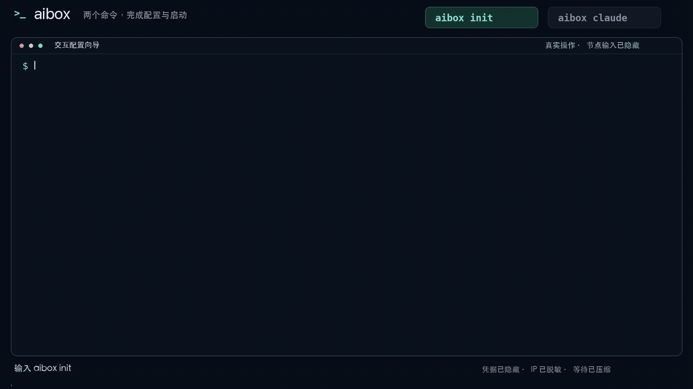
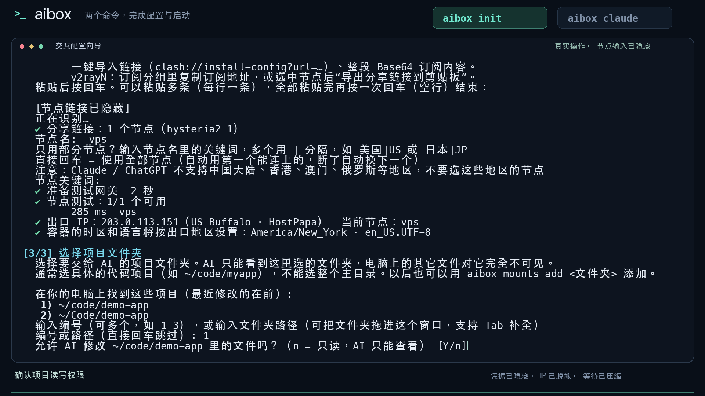
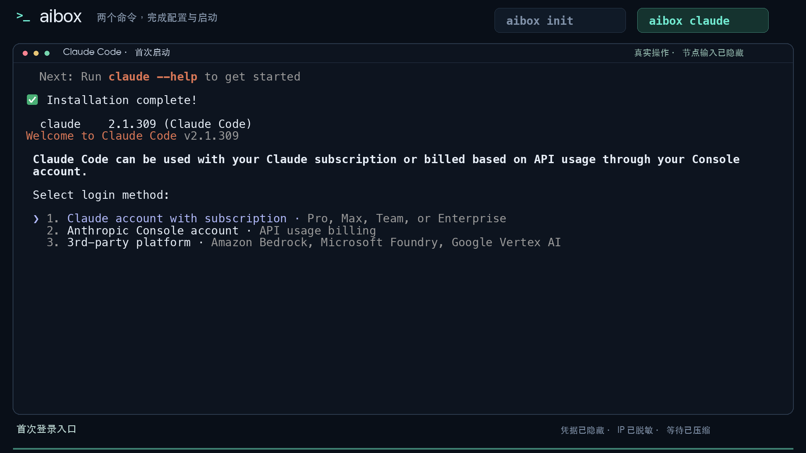

# aibox

<div align="center">
  <h3>Claude Code 用独立网络，只打开你允许的项目。</h3>
  <p>在自己的终端里写代码，其他应用照常上网。</p>
  <p>
    
    
  </p>
  <p><a href="#quick-start">快速开始</a> · <a href="#demo">完整演示</a> · <a href="#compare">本机对比</a> · <a href="#faq">常见问题</a> · <a href="docs/GUIDE.md">使用指南</a></p>
</div>

你照常用现在的终端。aibox 把 **Claude Code / Codex** 放在单独的 Docker 环境里，上网用你选的远程节点，本机文件只开放你选中的项目文件夹。

## 为什么用 aibox？

| 你关心的事 | aibox 怎么做 |
|---|---|
| AI 要走节点，其他应用照常用 | 只接管 aibox 里的网络，不改其他软件的网络设置 |
| 节点掉线，担心改走直连 | 连接失效时阻断联网，不自动换回电脑原本的网络 |
| 不想把整台电脑交给 AI | 只开放选中的项目，每个目录可选“允许修改”或“只读” |
| 不想把工具和依赖装在本机 | AI 工具在单独环境里安装，关掉再开保留工具和登录信息 |
| 想少露一些电脑信息 | 使用独立机器标识，默认遮住硬件目录；实际效果可以直接对比 |
| 长任务想稍后回来继续 | 用 `aibox tmux` 保留会话，电脑和 Docker 需要保持运行 |

> aibox 不附带节点，不会替浏览器换网络，也不能保证不封号。CPU、内核和部分机器信息仍可能可见。[查看具体边界](#security)

<a id="demo"></a>

## 两个命令，看完整操作

配置用 **`aibox init`**，日常使用用 **`aibox claude`**。



[下载完整视频 · 1080p MP4](https://github.com/seqi781/aibox/raw/refs/heads/main/docs/media/aibox-init-claude.mp4) · [跳到安装步骤](#quick-start)

演示包含：粘贴节点、选择项目、设置能不能修改文件，最后打开 Claude Code 登录入口。节点链接和 IP 已隐藏，下载与启动的等待已加快；没有登录个人账号或调用模型。

<a id="quick-start"></a>

## 快速开始

### 先准备好

- **Docker 已安装并打开**：macOS、Linux 可直接使用；Windows 在 WSL2 里运行。
- **能用的远程节点、订阅链接或 VPN 配置**：已有 Clash / v2rayN 的远程节点可以复用，但不能填写它们的本地代理端口。
- **要交给 AI 的项目文件夹**：只选具体项目，再决定能不能修改。

<details>
<summary>还没装 Docker？按系统查看</summary>

| 系统 | 准备方式 |
|---|---|
| macOS | 打开已有的 OrbStack、Docker Desktop 或 Colima；也可按 [Docker Desktop 安装说明](https://docs.docker.com/desktop/setup/install/mac-install/) 准备 |
| Linux | 按 [Docker 安装说明](https://docs.docker.com/engine/install/) 安装 Docker Engine、Compose v2 并启动 Docker |
| Windows | 安装 Docker Desktop 并开启 [WSL2 集成](https://docs.docker.com/desktop/features/wsl/)，后续在 WSL 终端中操作 |

装好后新开终端。aibox 会检查 Docker 能不能用，有问题会提示处理方法。

</details>

### 1. 下载，跟着提示配置

```bash
git clone https://github.com/seqi781/aibox.git ~/aibox
cd ~/aibox
./aibox init
```

| 向导步骤 | 你需要做什么 |
|---|---|
| ① 环境检查 | 检查 Docker，有问题按提示处理 |
| ② 网络出口 | 粘贴远程节点或订阅，也可以用 VPN 配置；立即测试能不能连上 |
| ③ 项目目录 | 选择文件夹，再选“允许修改”或“只读” |

问是否安装 `aibox` 命令时选“是”，以后在任意终端都能使用。确认立即启动后会显示检查结果；时区和语言按节点地区设置，AI 工具第一次使用时自动安装。

### 2. 在项目里打开 Claude Code

第一次装好命令后，新开一个终端窗口：

```bash
cd ~/code/myapp   # 换成刚才选好的项目文件夹
aibox claude
```

第一次按提示登录，以后再打开会保留安装内容和已保存的登录信息。想用 Codex，运行 `aibox codex`。

看到 Claude Code 的登录页或主界面，就走通了。上网不正常，用 `aibox doctor` 查看原因；改节点或项目，用 `aibox config`。

<details>
<summary>想让 AI 帮你配置？复制这段话</summary>

```text
请帮我在本机配置 aibox：
https://github.com/seqi781/aibox

先看项目里的 AGENTS.md，检查 Docker 能不能用。
问清楚我用哪个远程节点、选哪个项目文件夹、能不能修改文件，不要替我猜。
节点链接、密码和密钥由我在本机输入，不要放进聊天、截图或提交里。
按 AGENTS.md 的说明配置好，实际测试，有需要注意的地方就告诉我。
最后教我在选好的项目文件夹里运行 aibox claude。
```

</details>

<a id="compare"></a>

## 本机 vs aibox，直接看数据

```bash
aibox compare
```

本机和 aibox 并排显示实际 IP、系统、CPU、内存、电脑名和文件权限。输出样式示意，下面的 IP 与数值均为示例：

```text
项目          本机                    aibox                   对比
IPv4          192.0.2.10              198.51.100.20           ✓ ≠
系统          macOS                   Debian GNU/Linux       ✓ ≠
CPU核心       10                      10                     ⚠ =
内存          24.0 GiB                7.8 GiB                ✓ ≠
硬件目录      可读                    已遮挡                 ✓ 受限
本机文件      当前用户权限            1 可写 / 1 只读        ✓ 受限
```

`✓` 不同或受限 · `⚠` 相同或仍可见 · `—` 未验证。机器 ID、开机 ID 只显示前 8 位。结果比较的是工具能接触的信息，不是封号概率。

- 截图分享用 `aibox compare --redact`，隐藏 IP、电脑名和 ID。
- 不查询上网 IP，用 `aibox compare --offline`。
- 更新前的旧容器不算已受保护；新防护需要重建后生效，对比命令不会替你中断任务。

## 日常命令

| 命令 | 用来做什么 |
|---|---|
| `aibox init` | 第一次配置 |
| `aibox claude [项目]` | 打开 Claude Code，第一次自动安装 |
| `aibox codex [项目]` | 打开 Codex |
| `aibox shell [项目]` | 进入 aibox 的命令行，`exit` 返回 |
| `aibox tmux [项目]` | 离开终端后保留任务会话 |
| `aibox status` | 看运行状态和出口 IP |
| `aibox compare` | 本机与 aibox 的实际数据对比 |
| `aibox doctor` | 检查网络、断线保护和配置问题 |
| `aibox config` | 换节点、调整项目及读写权限 |
| `aibox restart` | 重新启动，让修改后的设置生效 |
| `aibox stop` | 停止，保留项目、工具和登录信息 |

先 `cd` 到选好的项目文件夹再启动，也可写项目名，例如 `aibox claude myapp`。想模拟一次节点断线，运行 `aibox doctor --full`；它会临时中断 aibox 的网络。

<a id="faq"></a>

## 常见问题

**我已经在用 Clash / v2rayN，还需要另外买节点吗？**

只要现有远程节点或订阅能用，就可以复用。配置时粘贴链接，不是填写电脑上 Clash / v2rayN 的本地代理地址。

**AI 修改的文件会同步到我的项目吗？**

文件就在原来的文件夹里。“允许修改”会真的改动本机文件；“只读”只能看、不能改。不要开放整个用户文件夹或存放密码、密钥的目录。

**为什么本机与 aibox 显示相同 IP？**

本机也可能在用同一节点，不能只凭相同 IP 就认定泄漏。如果没有查到本机直连出口，就还无法确认真实宽带 IP 的区别。可以用 `aibox doctor --full` 另外验证断线阻断。

**显示“网关不健康”、启动不了或没法上网怎么办？**

先用 `aibox doctor` 看提示，再用 `aibox config` 检查节点；改好后 `aibox restart`。不需要改本机全局网络。

**中风险、高风险，或者 IP 评分是什么意思？**

先看具体原因，例如连接失败、节点地区、机房 IP、代理标记或滥用记录。第三方评分和检测报告只是参考，不能换算成封号概率；没有查到也不代表没有风险。

**关掉终端、合上电脑，任务还能继续吗？**

`aibox tmux` 可以在关闭终端窗口后保留会话，再运行同一命令回来。电脑和 Docker 必须保持运行；合盖休眠、退出 Docker 或停止 aibox，都不能保证任务继续。

**需要指纹浏览器吗？**

aibox 提供终端环境，不附带浏览器。你在自己的浏览器里打开登录链接时，走的是浏览器自己的网络，aibox 不会替它换网络。

<a id="security"></a>

## 使用前，先了解这些边界

aibox 帮你限制工具的网络和文件范围，不会让电脑或登录账号完全匿名。

<details>
<summary>IP、机器信息、文件和登录记录，哪些仍可能暴露？</summary>

- **上网 IP**：aibox 里的工具通过节点联网，对面的服务看到节点 IP；节点服务商仍能看到你连过去的来源 IP。自己的浏览器和其他软件使用各自的网络。
- **本机文件**：选中的项目、Git 提交记录或另外传入的设置，仍可能包含姓名、邮箱和密钥。aibox 不会替你清理这些内容，挂载信息也可能带出本机路径。
- **机器信息**：使用容器自己的电脑名和独立机器标识，默认遮住硬件目录；CPU 架构、部分 CPU / 内存信息、内核及 Linux 开机标识仍可能可见，工具也可能识别出容器。
- **安装和检查**：镜像构建、节点配置下载、节点地址查询可能使用本机网络。环境检查还会访问第三方 IP / DNS 服务，它们会看到查询来源；对比表默认显示实际 IP，公开截图前用 `--redact`。
- **登录和记录**：工具、凭据、命令历史保存在独立 home 中。停止或重启不会自动退出账号、清空记录；使用同一账号仍可被关联。
- **兼容性**：硬件目录遮挡可能影响 GPU、设备发现和监控工具，调整方式见 [使用指南](docs/GUIDE.md#hardware-privacy)。
- **账号限制**：aibox 不关闭 AI 工具自身的信息收集，不修改账号标识，不保证不封号。账号、使用行为、节点及平台规则仍然重要。

完整说明见 [架构与安全设计](docs/ARCHITECTURE.md)。

</details>

<details>
<summary>想了解原理？查看技术要点与方案对比</summary>

| 技术要点 | 实际作用 |
|---|---|
| 网关和工作区分开 | 管网络的容器与运行 AI 的容器分开；工作区移除改路由、防火墙所需的关键权限 |
| 断线阻断 | 先设置阻断规则，再连接节点；节点失效或列表为空时不回落直连 |
| DNS / IPv6 防护 | 网关接管 DNS，限制绕过隧道的连接；可用体检验证 |
| 项目读写权限 | 只挂选中的目录，只读由系统限制；用户编号对齐，方便继续编辑文件 |
| 原生终端与 tmux | 直接接入自己的终端；启动工具时交接进程，长任务可放入可恢复会话 |
| 机器信息防护 | 独立机器标识和硬件目录遮挡，减少一部分本机信息暴露 |

| 方式 | 网络影响范围 | 文件范围 | 断线处理 |
|---|---|---|---|
| 本机代理 / VPN | 取决于软件和分流设置 | 本机用户权限及工具授权 | 取决于客户端和规则 |
| 只设 `HTTP_PROXY` | 遵守代理变量的程序 | 取决于运行环境 | 取决于配置 |
| 完整虚拟机 | 虚拟机里的程序 | 虚拟机和共享目录 | 取决于虚拟机网络配置 |
| **aibox** | **从 aibox 里启动的程序** | **指定项目及其读写权限** | **内置断线阻断，可模拟验证** |

macOS 下仍需要 Docker 的 Linux 运行环境，但不必另外配置完整虚拟机。整体内存和启动耗时取决于 Docker、工具及任务。

这些机制不能保证免疫恶意提示词、阻止所有容器逃逸或隐藏全部硬件信息。详见 [架构](docs/ARCHITECTURE.md) 和 [代码地图](docs/CODEMAP.md)。

</details>

## 文档、服务与交流

- [使用指南](docs/GUIDE.md)：配置、登录、常用操作和报错处理。
- [提交问题或建议](https://github.com/seqi781/aibox/issues)：写清系统、操作和报错，隐藏节点链接、密码、密钥及真实 IP。
- [UseHooo 服务页面](https://usehooo.com/aibox)：配置协助及相关服务；具体项目与售后规则以服务页面为准。
- [Telegram 交流入口](https://t.me/+3wcYpPtDyR9lNjE1)。

<details>
<summary>查看配置截图、宣传素材与开发文档</summary>

| `aibox init`：选择项目与权限 | `aibox claude`：首次启动 |
|---|---|
| [](docs/media/configuration.png) | [](docs/media/claude-start.png) |

[完整宣传素材](docs/media/README.md) · [代码地图](docs/CODEMAP.md) · [AI agent 操作规则](AGENTS.md) · [测试目录](tests/)

`config/`、`.aibox/` 和 Claude 的本地设置默认不进 Git。不要把其中的节点链接、密码或密钥另外复制进项目文件或 Issue。

</details>
