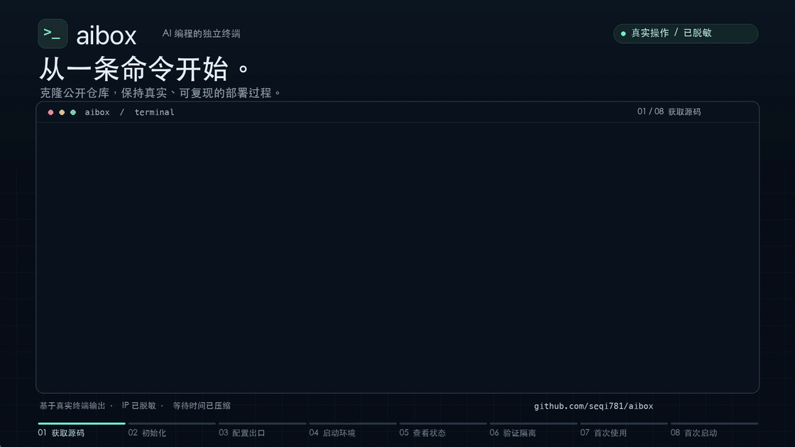
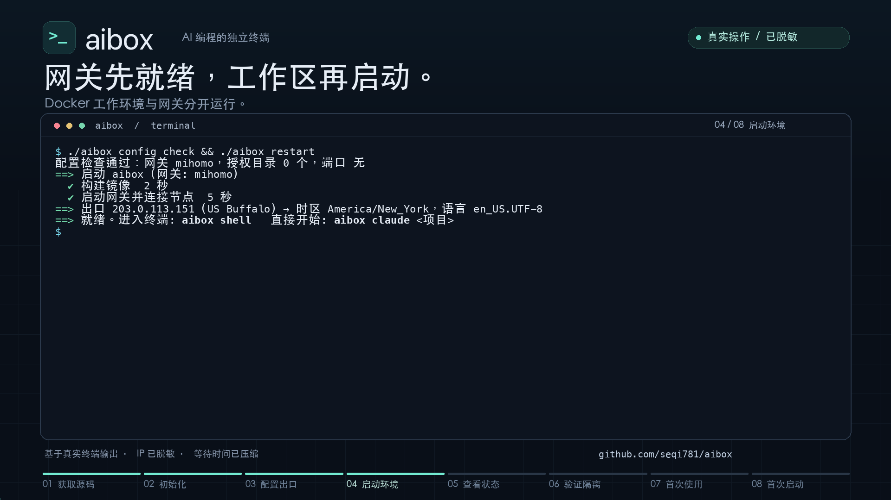
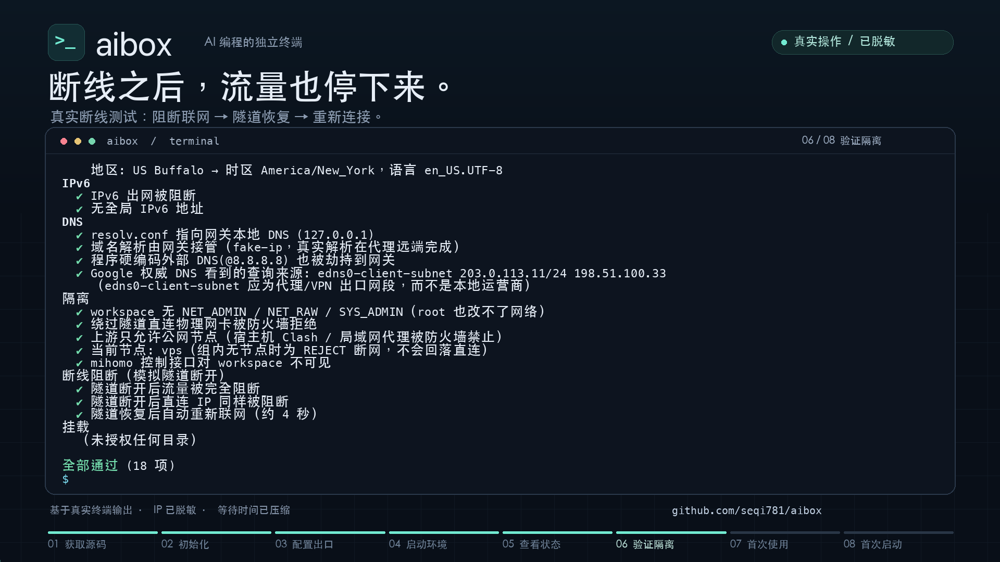

# aibox

**为 Claude Code 等 AI 编程工具提供独立网络出口与宿主机隔离的 Docker 终端。** 支持 **macOS 和 Linux**，Windows 可在 WSL2 中使用。



[下载完整视频 · 1080p MP4](https://github.com/seqi781/aibox/raw/refs/heads/main/docs/media/aibox-deploy-to-use.mp4) · [宣传封面与全部素材](docs/media/README.md)

演示包含获取源码、初始化、导入并测试节点、启动容器、验证断线阻断，以及 Claude Code 的自动安装与首次登录入口。基于真实终端输出制作，凭据输入隐藏，公网 IP 已脱敏，等待时间已压缩；没有登录个人账号或发起模型请求。

aibox 的核心用途是：让 Claude Code 在容器里通过远程代理或 VPN 联网，尽量避免向 AI 服务直接暴露宿主机的真实公网 IP 和本机环境信息，以降低相关账号风控与封号风险。Codex 等终端工具也可以使用同一套环境。

**aibox 不保证防封号，也不提供完整的机器指纹伪装。** 它提供网络与文件隔离；账号身份、使用行为、出口 IP 信誉和服务规则仍会影响账号状态。具体保护范围见下方说明。

## 能做什么

- **完整终端**：直接用你的系统终端进入，bash、git、node、python、编译工具链都有；长任务可以放进可恢复的会话
- **独立出口**：工作容器的运行时流量强制走远程代理或 VPN，提供 DNS、IPv4、IPv6 泄漏防护和断线阻断，不改动你电脑的网络
- **文件授权**：只有你选的项目文件夹对容器可见，每个文件夹单独设置能否修改
- **人和 AI 都能配置**：人用交互式向导；AI agent 用非交互命令（见 [AGENTS.md](AGENTS.md)）

文档：[使用指南](docs/GUIDE.md) · [架构与安全设计](docs/ARCHITECTURE.md) · [代码地图](docs/CODEMAP.md) · [AI agent 操作规则](AGENTS.md)

| 容器启动 | 网络隔离与断线阻断体检 |
|---|---|
| [](docs/media/deployment.png) | [](docs/media/network-check.png) |

## 真实 IP、机器信息与账号风险

| 关注点 | aibox 的保护范围 | 仍然存在的边界 |
|---|---|---|
| 真实公网 IP | 容器内 Claude Code 的联网请求经远程节点发出，目标服务看到节点的出口 IP；网关断线时阻断联网 | 宿主机浏览器、宿主机上的其他程序不在保护范围内；代理 / VPN 服务商仍能看到连接来源 |
| 宿主机文件与环境 | 使用独立的容器文件系统和 home 卷，只把你授权的项目目录交给工具 | 已授权文件、项目的 Git 元数据、主动传入的环境变量仍可能包含本机或身份信息 |
| 机器信息 | 工具运行在 Linux 容器环境，减少直接接触宿主机系统与个人配置 | 容器仍可见内核、CPU 架构、部分资源信息；UID/GID 与宿主机对齐，不承诺隐藏全部硬件特征或消除设备关联 |
| 账号风控与封号 | 提供独立出口、断线阻断和环境检查，帮助发现网络与配置问题 | 不修改 AI 工具自身的遥测或账号标识；检测结果不代表服务商的风控结论，不能保证账号不被限制 |

以下流量也需要区分：

- **浏览器登录授权**：在宿主机浏览器中打开的登录链接使用浏览器自己的网络，aibox 不会代理它。
- **初始化与构建**：镜像拉取、构建、订阅预检与首次订阅下载，以及代理节点域名的引导解析，可能使用宿主机或网关的直连网络，不属于工作容器内 AI 请求的代理链路。
- **环境检查**：为对比本机与代理出口，检测过程会从宿主机向第三方 IP / DNS 检测服务发起请求；这些检测服务会看到本机 IP。报告也可能包含真实 IP，分享前请脱敏。

登录凭据与 AI 工具保存在独立的 Docker home 卷中，停止、重启容器不会清除。环境检查通过只代表已检查的项目通过；完整设计与已知限制见 [架构与安全设计](docs/ARCHITECTURE.md)。

## 安装

**1. 安装 Docker**

| 系统 | 命令 |
|---|---|
| macOS | `brew install orbstack`（或 Docker Desktop），然后启动它 |
| Linux | `curl -fsSL https://get.docker.com \| sudo sh && sudo usermod -aG docker $USER`，然后重新登录 |
| Windows | 安装 Docker Desktop 并开启 WSL2 集成，之后在 WSL 终端里操作 |

**2. 获取 aibox 并运行配置向导**

```bash
git clone https://github.com/seqi781/aibox.git ~/aibox
cd ~/aibox
./aibox init      # 3 步：环境检查 → 粘贴订阅或分享链接（自动识别并测试）→ 选择项目文件夹
```

向导里会问是否安装 `aibox` 命令，选"是"以后就能在任意目录使用。

需要准备远程代理订阅、节点分享链接或 VPN 配置，以及准备授权的项目目录。aibox 不附带节点，也不接受宿主机上的 Clash / v2rayN 本地代理端口作为上游。

## 使用

只需要这 10 个命令（只输入 `aibox` 也会显示）：

| 命令 | 作用 |
|---|---|
| `aibox init` | 第一次使用：配置向导 |
| `aibox claude [项目]` | 启动 Claude Code（第一次运行时自动安装） |
| `aibox codex [项目]` | 启动 Codex |
| `aibox shell [项目]` | 进入容器终端（`exit` 退出） |
| `aibox tmux [项目]` | 进入可恢复的会话：关掉终端窗口，里面的程序也继续运行 |
| `aibox status` | 查看运行状态和出口 IP |
| `aibox stop` | 停止（数据保留） |
| `aibox restart` | 重启；修改配置后用它让配置生效 |
| `aibox doctor` | 检查网络、断网保护和环境风险 |
| `aibox config` | 修改配置（网络出口、项目文件夹） |

```bash
cd ~/code/myapp
aibox claude        # 在这个项目里启动 Claude Code
aibox tmux          # 长任务：进入会话后运行 claude；Ctrl+b 再按 d 离开，再次运行 aibox tmux 回来
```

- 先 `cd` 到项目文件夹再运行，就进入容器里对应的位置；也可以写项目名：`aibox claude myapp`。
- 第一次运行 `claude` / `codex` 时按提示登录一次，登录状态会一直保存。
- 更多说明见 [使用指南](docs/GUIDE.md)。

## 常见问题

- **我用的是 v2rayN / Shadowrocket / Clash Verge，能用吗？** 能。运行 `aibox config`，把订阅链接或节点分享链接粘贴进来，格式会自动识别。
- **能不能直接用电脑上正在运行的 Clash？** 不能，这是有意的设计：Clash 的分流规则可能让部分流量直连，出口就不受控了。请把 Clash 里的订阅链接粘贴进来。
- **启动时报网关不健康**：节点连不上，或订阅失效。运行 `aibox doctor` 查看原因。
- **AI 工具怎么装？** 不用装，第一次运行 `aibox claude` / `aibox codex` 时自动安装。
- **时区和语言？** 自动按代理出口 IP 的地区设置，和出口保持一致。
- **怎么检查网络隔离？** 运行 `aibox doctor`，检查网络与配置，并查看出口 IP 的风险判定；`aibox doctor --full` 还会模拟断线，验证阻断行为。结果不能作为防封号保证。
- **订阅、密钥和登录信息会提交到 GitHub 吗？** 本地配置 `config/` 和运行数据 `.aibox/` 已被 Git 忽略；容器登录凭据保存在 Docker home 卷。不要把这些内容另存到项目文件或贴进 issue，分享日志和报告前先脱敏。
