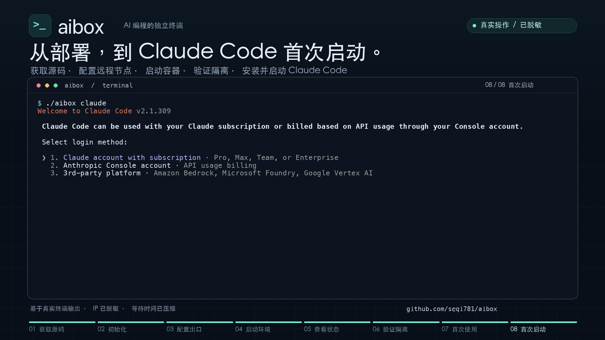

# aibox 终端演示与宣传素材

这是一段从部署到 Claude Code 首次启动的真实终端演示，可直接用于项目介绍和宣传。

| 文件 | 用途 |
|---|---|
| [完整视频 MP4](aibox-deploy-to-use.mp4) | 1920 × 1080，H.264，无音轨；适合演示、分享及上传视频平台 |
| [循环动画 GIF](aibox-deploy-to-use.gif) | 适合 GitHub README、文章和支持动图的页面 |
| [视频封面 PNG](cover.png) | 1920 × 1080，适合视频封面与宣传卡片 |
| [容器启动截图](deployment.png) | 真实启动输出 |
| [网络隔离体检截图](network-check.png) | 真实完整体检输出，包含断线阻断和自动恢复 |
| [脱敏录制数据](terminal-recording.json) | 各阶段的终端输出与相对时间，供检查和重新排版 |

## 演示流程

1. 从 GitHub 克隆仓库。
2. 通过非交互接口生成默认配置。
3. 从标准输入导入远程节点，隐藏凭据输入，实际测试节点连通性与出口。
4. 校验配置，构建并启动网关与工作容器。
5. 查看运行状态和独立出口。
6. 运行完整体检，实际模拟隧道断开，验证阻断与自动恢复。
7. 首次运行 Claude Code，通过网关自动安装并验证版本。
8. 启动官方 CLI，停在首次登录选择页。

没有登录任何个人账号，没有发起 AI 模型请求。视频展示的代码差异预览来自 Claude Code 自带的主题选择界面，并非模型生成的回答。

## 录制与隐私处理

- 命令输出来自真实的伪终端录制，章节标题、边框和进度条属于视频排版。
- 公网 IP 已替换为文档示例地址；本机路径、节点链接和凭据不会公开。
- 等待时间经过压缩，录制使用了已有的 Docker 镜像构建缓存，不构成部署耗时承诺。
- 为保护原有工作任务，演示使用单独的 Docker 容器和数据卷，只替换资源名称，没有改变代理、防火墙或工具运行逻辑。
- 演示没有挂载宿主机项目目录。真实使用时，请通过 `aibox init` 或 `aibox config` 授权自己的项目目录。
- 原始录制保存在本机被 Git 忽略的目录中；仓库只发布脱敏后的素材。

网络体检通过只代表本次检查项目通过，不等于出口 IP 低风险，也不保证避免账号限制。完整保护范围见 [架构与安全设计](../ARCHITECTURE.md)。
